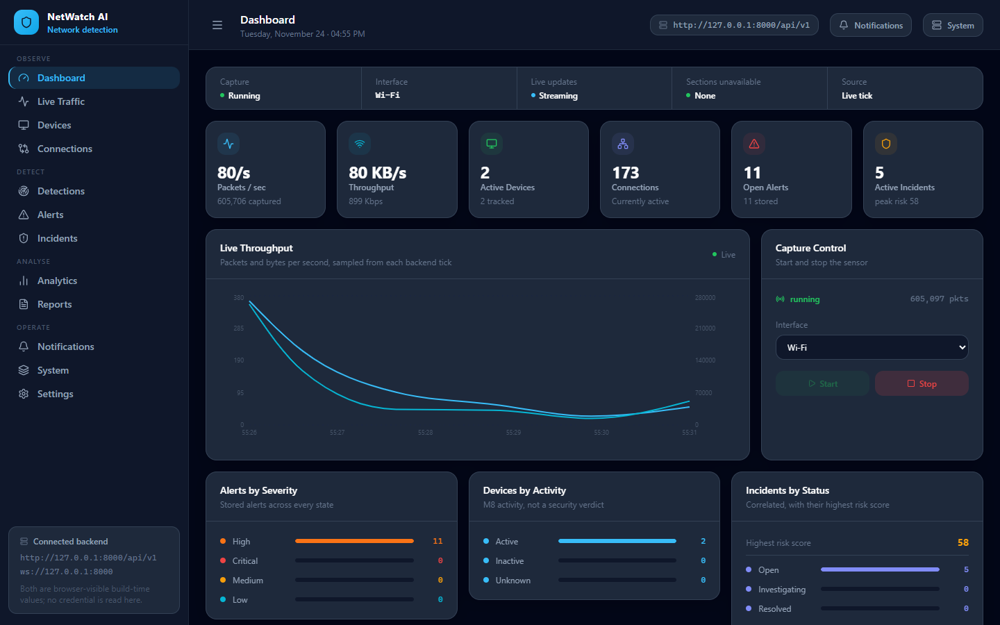
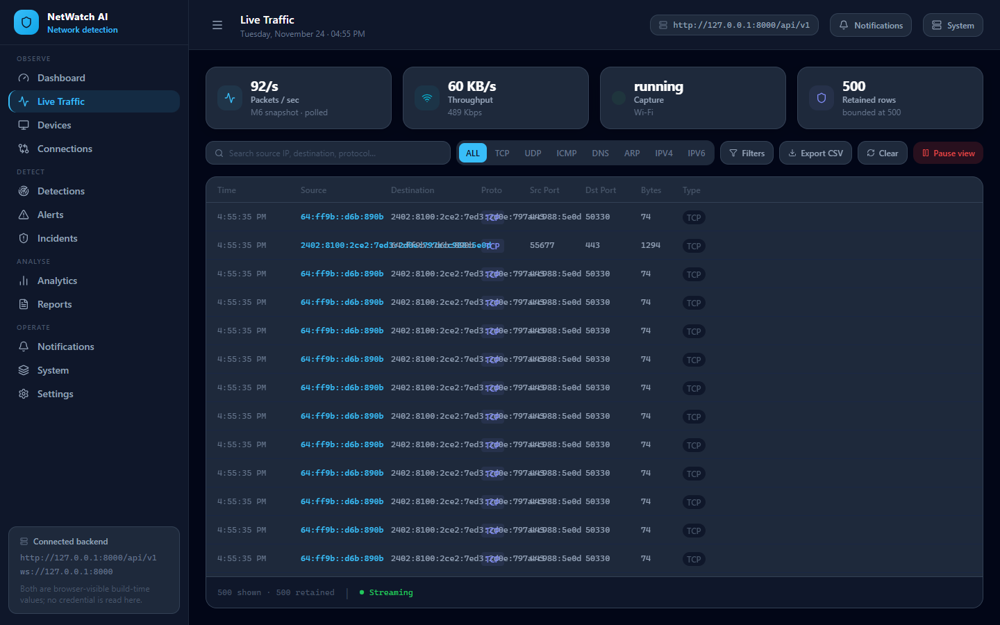

# NetWatch AI

A **local-first** network monitoring and security-analysis platform. It captures
packets from a network interface, turns them into traffic statistics, devices and
conversations, runs a rule-based detection engine over them, raises and correlates
alerts into scored incidents, and presents all of it in a real-time React dashboard.

Everything runs on one machine. There is no cloud service, no account and no
external endpoint.

> **This application is not hardened for a network.** It has no authentication, no
> authorisation and no TLS, and it binds to loopback by default. Run it on a machine
> you control, for traffic you are authorised to capture. See
> [Security limitations](#security-limitations).

---

## 1. What it does

| Stage | What happens |
| --- | --- |
| Capture | Packets are read from a chosen interface (Scapy) |
| Processing | Frames are normalized into one packet model; malformed frames are isolated, never fatal |
| Statistics | Totals, rates, protocol/direction/port/talker breakdowns over 1 s / 10 s / 60 s windows |
| Persistence | Packet metadata is written to SQLite in bounded batches by a background worker |
| Devices | Devices are discovered and tracked by MAC, with IP history |
| Baselines | Per-device behavioural profiles are learnt over 60 s windows and kept across restarts |
| Connections | Packets are grouped into bidirectional conversations with state and counters |
| Detection | Five rules: port scan, SYN flood, ICMP flood, internal scan, high bandwidth |
| Alerts | Findings become alerts with severity, confidence, evidence and a lifecycle |
| Correlation | Related alerts form incidents with explicit correlation reasons |
| Risk | Incidents receive a bounded 0–100 risk score and a display band |
| API | One versioned REST surface under `/api/v1` with a single response envelope |
| Real time | Four WebSocket channels: `/ws/dashboard`, `/ws/packets`, `/ws/alerts`, `/ws/system` |
| Analytics | Historical traffic, protocol, device, connection and threat views |
| Reporting | CSV and PDF reports over a chosen period, stored and downloadable |
| Dashboard | A React/TypeScript frontend rendering all of it from real data |

No mock data, no simulated traffic and no invented metrics exist in the frontend.
Every figure on screen came from the backend.

---

## 2. Requirements

| Requirement | Version | Notes |
| --- | --- | --- |
| **Python** | 3.12 or newer | Developed and verified on **3.13.2** |
| **Node.js** | 20 or newer, with `npm` | Developed and verified on Node 22 / npm 10 |
| **OS** | Windows 10/11, or any POSIX system | The documented commands use PowerShell; the Python side is portable |
| **Disk** | ~500 MB | Dependencies, the SQLite database and generated reports |
| **Privileges** | **Administrator, for live capture only** | Whether it is required depends on how Npcap/libpcap was installed. See [Capturing packets](#54-capturing-packets). Every other step, and the whole test suite, runs unelevated. |

Nothing else is required: no Docker, no database server, no external account, no
API key.

---

## 3. Install

Both halves install independently. The backend is the system; the frontend is a
client of it.

### 3.1 Backend

From the repository root:

```powershell
python -m venv backend/.venv
backend\.venv\Scripts\python.exe -m pip install --upgrade pip
backend\.venv\Scripts\python.exe -m pip install -r backend\requirements.txt
```

`backend/.venv` is the environment every script and the quality-gate runner expect.
If it is absent, the gate runner falls back to whatever interpreter runs it and
reports a missing prerequisite rather than guessing.

### 3.2 Frontend

```powershell
cd frontend
npm ci
```

`npm ci` installs exactly the versions in `frontend/package-lock.json`.

**`package-lock.json` is the canonical lockfile.** The repository also contains a
`pnpm-lock.yaml` left over from the template the frontend started as; it is not
used, not maintained, and not verified. Use `npm`.

---

## 4. Configure

Configuration is environment variables, optionally in a `.env` file. Templates are
committed; real files are not.

```powershell
Copy-Item backend/.env.example backend/.env
Copy-Item frontend/.env.example frontend/.env.development
```

Every value in both templates has a working default. **You can start the
application without editing either file.**

The settings that matter for a first run:

| Variable | Default | Meaning |
| --- | --- | --- |
| `HOST` | `127.0.0.1` | The interface the API binds to. Loopback by design. |
| `PORT` | `8000` | The API port |
| `DATABASE_URL` | `sqlite:///./netwatch.db` | The store, relative to the working directory |
| `DEFAULT_CAPTURE_INTERFACE` | *(blank)* | An interface to select at startup, e.g. `Wi-Fi` |
| `PACKET_RETENTION_DAYS` | `30` | `0` keeps packets forever |
| `RETENTION_SWEEP_INTERVAL_SECONDS` | `3600` | How often retention runs; `0` disables it |
| `REPORT_STORAGE_DIR` | `reports` | Where generated reports are written |
| `REPORT_RETENTION_DAYS` | `0` | **`0` keeps every report.** Report cleanup is opt-in. |
| `LOG_LEVEL` | `INFO` | Python log level |

Frontend variables (all inlined into the browser bundle, so **never** put a secret
in one):

| Variable | Default |
| --- | --- |
| `VITE_API_BASE_URL` | `http://127.0.0.1:8000/api/v1` |
| `VITE_WS_BASE_URL` | `ws://127.0.0.1:8000` |
| `VITE_API_TIMEOUT_MS` | `15000` |

**Settings are read at startup.** Changing a backend variable requires restarting
the backend; changing a `VITE_*` variable requires restarting the dev server, since
Vite inlines them at build time.

---

## 5. Run

Two processes, in two terminals.

### 5.1 Backend

```powershell
cd backend
.venv\Scripts\python.exe -m uvicorn app.main:app --host 127.0.0.1 --port 8000
```

| Surface | URL |
| --- | --- |
| API root | <http://127.0.0.1:8000/api/v1> |
| Health | <http://127.0.0.1:8000/api/v1/health> |
| Swagger | <http://127.0.0.1:8000/docs> |
| ReDoc | <http://127.0.0.1:8000/redoc> |

The SQLite schema is created on first start when `APP_ENV=development` (the
default). No migration step is needed for a fresh install, and upgrades to an
existing database are applied automatically and additively.

### 5.2 Frontend

```powershell
cd frontend
npm run dev
```

Vite serves on **`http://localhost:8443`** by default (`port: 8443` in
`frontend/vite.config.ts`; the dev server also listens on `0.0.0.0`, so
`127.0.0.1:8443` works too).
The backend's CORS allowlist already includes `localhost:8443` and
`127.0.0.1:8443`, so no configuration is needed for that pairing.

| Command | Purpose |
| --- | --- |
| `npm run dev` | Dev server on port 8443 |
| `npm run build` | Production build into `frontend/dist/` |
| `npm run preview` | Serve the built output |

### 5.3 Expected ports

| Port | Service |
| ---: | --- |
| 8000 | FastAPI backend (REST + WebSocket) |
| 8443 | Vite dev server |

Both are configurable. If you change the frontend port, add the new origin to the
backend's CORS allowlist (`cors_allow_origins` in `backend/app/config/settings.py`)
or every page will render as an error state.

### 5.4 Capturing packets

Capture is controlled from the API or the dashboard. **Whether it needs an elevated
shell depends on the capture driver.** An Npcap install with *"Restrict Npcap
driver's access to Administrators only"* ticked requires one; the default install
does not, and this release was verified capturing unelevated on Windows 11 with the
default. On Linux, `CAP_NET_RAW` or root is normally required. Try unelevated first
and elevate only if the start call reports a permission error.

```powershell
# List the interfaces the machine offers (each carries an `is_up` flag)
Invoke-RestMethod http://127.0.0.1:8000/api/v1/capture/interfaces

# Select one. The request field is `name`, not the display label — an unknown
# or down interface is refused with a 400 naming the field.
Invoke-RestMethod -Method Put http://127.0.0.1:8000/api/v1/capture/interface `
  -ContentType 'application/json' -Body '{"name":"Wi-Fi"}'

# Start and stop. Starting twice is a 409; stopping when idle is a 409.
Invoke-RestMethod -Method Post http://127.0.0.1:8000/api/v1/capture/start
Invoke-RestMethod -Method Post http://127.0.0.1:8000/api/v1/capture/stop
```

If the start call fails with a permission error, elevate the shell and retry.
Everything else — the API, the dashboard, analytics, reporting and the whole test
suite — runs unelevated regardless.

---

## 6. Verify an installation

One command runs every fast gate:

```powershell
backend\.venv\Scripts\python.exe backend\scripts\run_quality_gates.py
```

It exits `0` only when every selected gate ran and passed, and it prints each gate's
own summary line. A gate that cannot run is reported `SKIPPED` and fails the run —
a skipped gate never counts as a pass.

```powershell
# Add the three long gates: end-to-end, live server, performance
backend\.venv\Scripts\python.exe backend\scripts\run_quality_gates.py --full

# Inspect what each gate runs, and what it needs
backend\.venv\Scripts\python.exe backend\scripts\run_quality_gates.py --list
```

The individual commands:

| Check | Command |
| --- | --- |
| Backend suite | `backend\.venv\Scripts\python.exe -m pytest -c backend\pytest.ini --rootdir backend backend\tests -q` |
| Backend types | `backend\.venv\Scripts\python.exe -m pyright` |
| End-to-end, in process | `backend\.venv\Scripts\python.exe backend\scripts\verify_m18.py sample` |
| End-to-end, over a socket | `backend\.venv\Scripts\python.exe backend\scripts\verify_m18.py live` |
| Performance | `backend\.venv\Scripts\python.exe backend\scripts\benchmark_m18.py` |
| Frontend unit | `npm --prefix frontend test` |
| Frontend types | `npm --prefix frontend run typecheck` |
| Frontend build | `npm --prefix frontend run build` |
| Frontend against a real backend | `npm --prefix frontend run test:live` |

The last one needs a backend listening on `127.0.0.1:8000`. The two `verify_m18.py`
modes start their own server and need nothing running.

`pyright` is used by the `backend-types` gate but is **not** in
`backend/requirements.txt`; install it alongside the requirements if you want that
gate to run:

```powershell
backend\.venv\Scripts\python.exe -m pip install pyright
```

---

## 7. Reports

Generated reports are written to `REPORT_STORAGE_DIR` (default `reports`, resolved
against the process's working directory) and are downloadable from
`GET /api/v1/reports/{id}/download`.

- **Nothing prunes report files by default.** `REPORT_RETENTION_DAYS=0` keeps every
  report and its file forever. Set a positive number to have old reports removed
  automatically, in bounded passes, with the metadata row and the file always
  removed together.
- The report directory is excluded from version control.
- A report is a snapshot: its figures describe the period as the store held it when
  the report was generated.

---

## 8. Project layout

```text
backend/
  app/            the application
    api/          REST routes, envelope, validation
    websockets/   the four real-time channels
    services/     capture manager, packet pipeline, retention scheduler
    processing/   frame normalization
    statistics/   traffic windows and rates
    persistence/  packet batching, retention
    devices/      discovery and identity
    baselines/    behavioural learning: features, aggregation, statistics, retention
    connections/  conversation tracking
    detection/    rules and engine
    alerts/       alert creation, dedup, lifecycle, evidence
    correlation/  incidents and grouping
    risk/         bounded risk scoring
    analytics/    historical aggregate views
    reports/      CSV/PDF generation, storage, retention
    database/     schema, seeding, additive upgrades
  tests/          the backend suite
  scripts/        verification scripts, benchmarks and the gate runner
frontend/
  src/pages/      one file per screen
  src/components/ shared UI, including the lazy-route boundary
  src/services/   the typed API client
  src/hooks/      data and WebSocket hooks
  tests/live/     the suite that runs against a real backend
docs/             design documents, one per milestone (01–25)
```

---

## 9. Common problems

| Symptom | Cause and answer |
| --- | --- |
| Every page shows an error state | The backend is not running, or the frontend port is not in the CORS allowlist |
| `capture/start` reports a permission error | The capture driver requires elevation — elevate the shell and retry. Otherwise check the interface name against `capture/interfaces` |
| A frontend gate reports a missing prerequisite | `frontend/node_modules` is absent: run `npm ci` in `frontend/` |
| `npm run test:live` fails naming `127.0.0.1:8000` | No backend is listening; start one |
| `e2e-live` cannot bind a port | A leftover server from an earlier run; it picks a free port itself |
| The build reports a chunk over 500 kB | Should not occur — routes are code-split — so check that the split is intact |
| The dashboard is empty | That is correct on a fresh database: start a capture and traffic appears |
| Reports pile up on disk | Set `REPORT_RETENTION_DAYS` to a positive value |
| The database grows without bound | `PACKET_RETENTION_DAYS=0` keeps packets forever; set a window and leave the sweep enabled |

---

## 10. Screenshots

Captured from the running release candidate at 1440×900, against a live capture on
`Wi-Fi`. No data in any screenshot is mocked or edited.





| Route | Screenshot |
| --- | --- |
| Dashboard | [`01-dashboard.png`](docs/assets/screenshots/01-dashboard.png) |
| Live Traffic | [`02-live-traffic.png`](docs/assets/screenshots/02-live-traffic.png) |
| Devices | [`03-devices.png`](docs/assets/screenshots/03-devices.png) |
| Connections | [`04-connections.png`](docs/assets/screenshots/04-connections.png) |
| Detections | [`05-detections.png`](docs/assets/screenshots/05-detections.png) |
| Alerts | [`06-alerts.png`](docs/assets/screenshots/06-alerts.png) |
| Incidents | [`07-incidents.png`](docs/assets/screenshots/07-incidents.png) |
| Analytics | [`08-analytics.png`](docs/assets/screenshots/08-analytics.png) |
| Reports | [`09-reports.png`](docs/assets/screenshots/09-reports.png) |
| Notifications | [`10-notifications.png`](docs/assets/screenshots/10-notifications.png) |
| System | [`11-system.png`](docs/assets/screenshots/11-system.png) |
| Settings | [`12-settings.png`](docs/assets/screenshots/12-settings.png) |

---

## 11. Security limitations

Stated plainly, because nothing else in this document should be read as a claim to
the contrary:

- **No authentication and no authorisation.** Every endpoint is open to anything
  that can reach the port.
- **No TLS.** Traffic between browser and API is plaintext.
- **Loopback binding.** `HOST` defaults to `127.0.0.1`, and the CORS allowlist names
  local origins only. **Do not expose this application to a network or the public
  internet.**
- **No multi-user support.** There is no notion of a user, a role or a session.
- **Capture needs privilege.** Run it deliberately, on traffic you are authorised to
  observe.

Authentication, RBAC and TLS are future work and are not implemented.

---

## 12. Documentation

| Document | Subject |
| --- | --- |
| `docs/01_Project_Overview.md` | What the project is |
| `docs/02_System_Architecture.md` | How the pieces fit |
| `docs/03_Database_Design.md` | Schema |
| `docs/04_API_Specification.md` | REST surface |
| `docs/08_Deployment_Guide.md` | Deployment notes |
| `docs/09_Test_Plan.md` | Testing approach |
| `docs/12`–`23` | One design document per milestone, M8–M19 |
| `docs/23_M19_Stabilization_Design.md` | The stabilization milestone |
| `docs/24_M20_Base_Application_Release.md` | The base-application release record |
| `docs/25_M21_Behavioral_Baseline_Engine.md` | The behavioural baseline engine |
| `docs/TODO.md` | Milestone-by-milestone status |

---

## 13. Future development

The release above is the **base network-monitoring application**. It is a complete,
working monitoring and rule-based detection platform, and it is not an AI system
yet. Everything in this section is **planned and not implemented** — no part of it
should be read as a current capability.

| Planned capability | Description |
| --- | --- |
| ML-based anomaly detection | Compare live traffic against the learnt baselines, so deviation rather than a fixed threshold triggers a finding (**M22**) |
| Locally hosted LLM | A model served on the same machine, so no traffic metadata leaves it |
| AI Security Analyst | Natural-language explanation of an incident and its evidence trail |
| Intelligent sequence-based log investigation | Reason over ordered event sequences rather than isolated rules |
| Wazuh integration | Ingest host and log telemetry alongside network flows |
| Threat-intelligence integration | Enrich observed addresses and ports with external reputation |
| MITRE ATT&CK integration | Map detections to techniques and tactics |

The detection engine as shipped is **deterministic and rule-based**: five explicit
rules with explicit thresholds. It detects what those rules describe, and it does
not detect everything.

**Behavioural baselines are implemented (M21); anomaly detection is not.** The
engine learns a robust statistical profile of each device's normal traffic and
persists it, and the Behavioral Baselines page shows what it learnt. It issues no
verdict: no score, no anomaly classification, no alert. Comparing a live window
against a profile is M22's work. An "Established" baseline means the device has
been watched long enough to describe, never that it is safe.

The name "NetWatch AI" refers to the project's direction; the AI layer is the next
development phase, not a description of this release.

---

## License

See [`LICENSE`](LICENSE).
